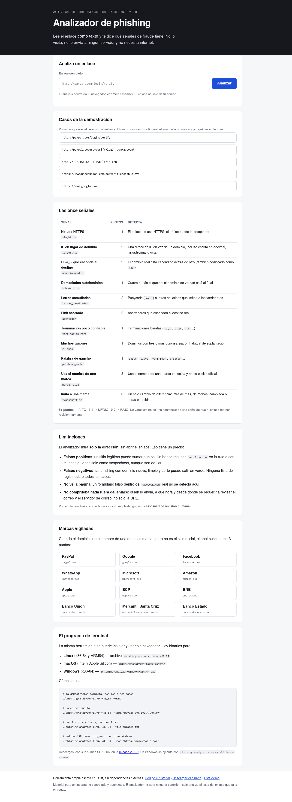

# Analizador de phishing

[](https://github.com/runer0101/analizador-phishing/actions/workflows/ci.yml)
[](https://runer0101.github.io/analizador-phishing/)
[](LICENSE)

Herramienta de seguridad para analizar enlaces sospechosos: **lee el enlace como texto** y
devuelve un veredicto de riesgo con el motivo de cada señal. **Nunca visita la URL**: no pide
DNS, no abre conexiones, no sale a internet.

- Rust, **cero dependencias externas**: solo la biblioteca estándar, sin dependencias
  que instalar ni que mantener al día
- Once señales con puntaje, veredicto en tres niveles
- Salida para terminal (con color) y salida JSON para máquinas
- La misma herramienta corre en el navegador con WebAssembly

> **Demo en vivo:** <https://runer0101.github.io/analizador-phishing/>
> El análisis ocurre en el navegador del visitante: el enlace no sale de su equipo.
>
> **Descargas:** [release v0.1.0](https://github.com/runer0101/analizador-phishing/releases/tag/v0.1.0)
> con binarios para Linux, macOS y Windows, y sus sumas SHA-256.

El proyecto hermano es [`honeypot-casero`](../honeypot-casero): una trampa que registra
lo que hace un atacante cuando entra, con su demo en vivo en
<https://runer0101.github.io/analizador-phishing/>.

## Instalación

Hace falta Rust 1.74 o superior. Nada más: sin Python, sin Docker, sin red.

```bash
git clone https://github.com/runer0101/analizador-phishing.git
cd analizador-phishing
cargo build --release
```

El binario queda en `target/release/phishing-analyzer`. También hay versiones ya compiladas
en la [release v0.1.0](https://github.com/runer0101/analizador-phishing/releases/tag/v0.1.0):

| Sistema | Archivo |
| --- | --- |
| Linux x86-64 | `phishing-analyzer-linux-x86_64` |
| Linux ARM64 | `phishing-analyzer-linux-aarch64` |
| macOS Intel | `phishing-analyzer-macos-x86_64` |
| macOS Apple Silicon | `phishing-analyzer-macos-aarch64` |
| Windows x86-64 | `phishing-analyzer-windows-x86_64.exe` |

En Linux y macOS hay que darle permiso de ejecución: `chmod +x phishing-analyzer-linux-x86_64`.

## Uso

```bash
# los cinco casos de la demostración, con su tabla resumen
target/release/phishing-analyzer --demo

# un enlace suelto
target/release/phishing-analyzer "http://paypa1.com/login/verify"

# una lista de enlaces (uno por línea; «#» inicia comentario)
target/release/phishing-analyzer --file enlaces.txt

# salida JSON para integrarlo con otro sistema
target/release/phishing-analyzer --json "https://www.google.com"

# sin color, para tuberías o para un proyector con poco contraste
target/release/phishing-analyzer --no-color "http://paypa1.com/login"

# explica cada señal en palabras llanas: qué significa y qué hacer
target/release/phishing-analyzer --explain "http://paypa1.com/login/verify"
```

## Las once señales

Cada señal suma puntos. El veredicto sale del total: **5 o más = ALTO**, **3 o 4 = MEDIO**,
**0 a 2 = BAJO**.

| Señal | Código | Puntos | Qué detecta |
| --- | --- | --- | --- |
| No usa HTTPS | `sin_https` | 1 | el enlace no usa HTTPS: el tráfico puede interceptarse |
| IP en lugar de dominio | `ip_dominio` | 2 | una IP en vez de un dominio, incluso en decimal (`2130706433`), hexadecimal (`0x7f000001`) u octal (`017700000001`) |
| El «@» que esconde el destino | `usuario_oculto` | 2 | el dominio real está escondido detrás de otro; también se ve si el «@» viene codificado (`%40`) |
| Demasiados subdominios | `subdominios` | 1 | cuatro o más etiquetas: el dominio de verdad está al final |
| Letras camufladas | `letras_camufladas` | 2 | punycode (`xn--`) o letras no latinas que imitan a las verdaderas |
| Link acortado | `acortador` | 2 | acortadores que esconden el destino real |
| Terminación poco confiable | `terminacion_rara` | 1 | terminaciones baratas (`.xyz`, `.top`, `.tk`…) |
| Muchos guiones | `guiones` | 1 | dominios con tres o más guiones (los de `xn--` no cuentan) |
| Palabra de gancho | `palabra_gancho` | 1 | `login`, `clave`, `verificar`, `urgente`… |
| Usa el nombre de una marca | `marca_falsa` | 3 | usa el nombre de una marca conocida y no es el sitio oficial |
| Imita a una marca | `typosquatting` | 3 | un solo cambio de diferencia: letra de más, de menos, cambiada o letras parecidas |

### Marcas vigiladas

PayPal, Google, Facebook, WhatsApp, Microsoft, Amazon, Apple y los bancos de Bolivia:
**BCP** (`bcp.com.bo`), **BNB** (`bnb.com.bo`), **Banco Unión** (`bancounion.com.bo`),
**Mercantil Santa Cruz** (`mercantilsantacruz.com.bo`) y **Banco Estado**
(`bancoestado.com.bo`).

### Cómo se detecta el typosquatting

Sin usar ninguna biblioteca: se comparan la primera parte del dominio y el nombre de la
marca con la **distancia de Damerau-Levenshtein** (cuántos cambios hay que hacer para pasar
de un texto a otro). Antes de comparar se normalizan los **homoglifos** (`rn` se lee como
`m`, `vv` como `w`, `0` como `o`, `1` como `l`, `3` como `e`, `5` como `s`, `7` como `t`).
Así se detectan tanto `paypa1.com` como `paypail.com`, `paypl.com`, `paypla.com` o
`payvwal.com`.

## Salida real

```
🔴 ALTO — 5 pts, 3 señales
  http://paypa1.com/login/verify
  dominio: paypa1.com
    +1  sin_https       No usa HTTPS: el tráfico puede interceptarse
    +1  palabra_gancho  Palabra de gancho: «login»
    +3  typosquatting   Imita a paypal.com con una diferencia mínima

URL                                               NIVEL  PTS  SEÑALES
--------------------------------------------------------------------------------
http://paypa1.com/login/verify                    ALTO     5  sin_https, palabra_gancho, typosquatting
http://paypal.secure-verify-login.com/account     ALTO     5  sin_https, palabra_gancho, marca_falsa
http://192.168.56.101/wp-login.php                MEDIO    4  sin_https, ip_dominio, palabra_gancho
https://www.bancounion.com.bo/verificacion-clave  BAJO     1  palabra_gancho
https://www.google.com                            BAJO     0
```

Y la salida en JSON:

```json
{
  "url": "http://paypa1.com/login/verify",
  "dominio": "paypa1.com",
  "nivel": "alto",
  "puntos": 5,
  "senales": [
    { "codigo": "sin_https", "puntos": 1, "detalle": "No usa HTTPS: el tráfico puede interceptarse" },
    { "codigo": "palabra_gancho", "puntos": 1, "detalle": "Palabra de gancho: «login»" },
    { "codigo": "typosquatting", "puntos": 3, "detalle": "Imita a paypal.com con una diferencia mínima" }
  ]
}
```

### Explicar cada señal

Con `--explain`, el programa dice en palabras llanas qué significa cada señal y qué hacer
ante ella. Las once explicaciones están en `EXPLICACIONES` (`src/lib.rs`) y las usa también
la página web.

## Limitaciones

El analizador mira **solo la dirección**, sin abrir el enlace. Eso tiene un precio:

- **Falsos positivos**: un sitio legítimo puede sumar puntos. Un banco real con
  `verificacion` en la ruta o con muchos guiones sale como sospechoso, aunque sea de fiar.
- **Falsos negativos**: un phishing con dominio nuevo, limpio y corto puede salir en verde.
  Ninguna lista de reglas cubre todos los casos.
- **No ve la página**: un formulario falso dentro de `facebook.com` real no se detecta aquí.
- **No comprueba nada fuera del enlace**: quién lo envía, a qué hora y desde dónde
  requeriría revisar el correo y el servidor de correo, no solo la URL.

Por eso la conclusión correcta no es «esto es phishing», sino **«esto merece revisión
humana»**.

## La demo del navegador

El motor de reglas está compilado a **WebAssembly**: la página analiza el enlace en el
equipo del visitante y **no lo envía a ningún servidor**. No hace falta internet en la
página una vez cargada.

- `src/lib.rs` es el motor de reglas, sin nada específico de la terminal.
- `src/wasm.rs` es toda la frontera con JavaScript: cuatro funciones para reservar
  memoria, analizar el enlace y devolver la memoria.
- `site/` es la página (HTML, CSS y JavaScript).



## Estructura

```
analizador-phishing/
├── src/
│   ├── lib.rs        # motor de reglas, análisis del enlace y veredicto
│   ├── main.rs       # CLI: tabla, JSON, archivos y modo demostración
│   ├── config.rs     # carga de las listas (una sola vez, con OnceLock)
│   └── wasm.rs       # frontera WebAssembly para la demo del navegador
├── datos/            # las cuatro listas, en texto plano (embebidas con include_str!)
├── tests/cli.rs      # pruebas de la CLI: códigos de salida y formato
├── site/             # la demo en el navegador (HTML, CSS, JS)
├── .github/workflows/
│   ├── ci.yml        # formato, lints, pruebas y compilación del wasm
│   ├── pages.yml     # publica la demo en GitHub Pages
│   └── release.yml   # binarios de Linux, macOS y Windows en cada tag
├── docs/
│   ├── PRESENTACION.md   # el guion completo de los 12 minutos
│   ├── GUION.md          # la parte del analizador
│   ├── DIAPOSITIVAS.md   # diapositivas 1 a 5
│   ├── ENSAYO.md         # ensayo sin internet y plan B
│   ├── CHECKLIST-EXPOSICION.md # los diez puntos del día de la exposición
│   └── captura-demo.png  # captura real de la demo en el navegador
└── scripts/
    ├── demo.sh          # la demostración del analizador en un comando
    └── estres-wasm.mjs  # test de fuga de memoria del módulo WebAssembly
```

### Las listas en texto plano

Las cuatro listas que se pueden cambiar sin tocar el código están en `datos/`, en texto
plano, y viajan **embebidas dentro del binario** (`include_str!`): no hace falta ningún
archivo suelto al ejecutar el programa.

| Archivo | Contenido | Formato |
| --- | --- | --- |
| `datos/palabras_gancho.txt` | 30 palabras de gancho | una por línea |
| `datos/acortadores.txt` | 10 acortadores | uno por línea |
| `datos/terminaciones.txt` | 10 terminaciones poco confiables | una por línea |
| `datos/marcas.txt` | 12 marcas con su sitio oficial | `marca \| sitio` |

En todas: las líneas que empiezan con `#` son comentarios. Cada lista se lee **una sola
vez** (un `OnceLock`), así que después de la primera llamada solo hay una lectura de
puntero.

## Verificación

```bash
cargo test                                              # 65 pruebas
cargo clippy --all-targets -- -D warnings
cargo fmt -- --check
cargo build --lib --release --target wasm32-unknown-unknown   # el motor de la web

# test de fuga de memoria del módulo WebAssembly: 1000 análisis seguidos
node scripts/estres-wasm.mjs
```

Las pruebas cubren cada señal por separado, los umbrales, el formato del JSON, los casos
de la demostración y los casos límite: entrada vacía, enlaces de 50 000 caracteres,
caracteres raros, sin esquema, en mayúsculas, con puerto, con punto final, con barras de
más, con «@» codificado, IP en decimal, hexadecimal y octal, letras no latinas y dominios
con el nombre de una marca en un subdominio.

## Aviso legal

Material para un laboratorio controlado y **autorizado**. El analizador **no abre ninguna
conexión**: analiza texto que el usuario le entrega. No escanea ni contacta a nadie.
